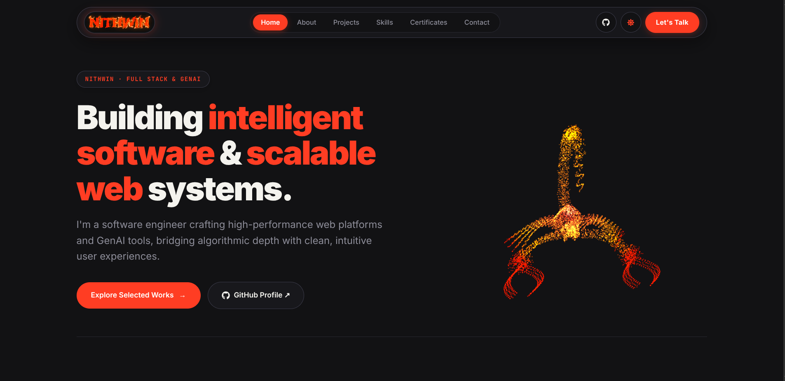

<div align="center">

# Nithwin · Portfolio

**Building intelligent software & scalable web systems.**

[](https://nithwin-portfolio.web.app)
[](https://github.com/Nithwin)
[](https://www.linkedin.com/in/nithwin-v-m-7b5b13252/)
[](https://leetcode.com/u/vmnithwin/)

<br />



<br />
<br />

<p align="center">
  Official portfolio of <b>Nithwin (Nithwin V M)</b> — Software Engineer specializing in high-performance web platforms, C++20 systems, and Generative AI developer tools.
</p>

</div>

---

## ⚡ Overview

I build software where performance meets intelligence. From developing full-stack web platforms and LLM-powered developer tools to solving 800+ algorithmic problems and publishing IEEE-recognized computer vision research, every system is engineered to be fast, reliable, and built to scale.

- 🌐 **Live Website**: [https://nithwin-portfolio.web.app](https://nithwin-portfolio.web.app) · [https://nithwin.site](https://nithwin.site)
- 📍 **Location**: India
- 🎓 **Education**: B.E. Computer Science, Nandha Engineering College (8.3 CGPA)
- 🔬 **Research**: Published in IEEE Xplore (*CA-YOLOv8 Real-Time Smart Card Detection*)

---

## ✨ Features & Architecture

- **3D Morphing Particle Sculpture**: Interactive Three.js WebGL visual with real-time morphing geometries (Orb, Scorpio, Neural Network, and Quantum Core).
- **Scrollytelling Manifesto**: Viewport-triggered word illumination engine and milestone progress tracking.
- **Interactive Project Showcase**: Filterable project gallery with technical modal walkthroughs, video demos, and architecture breakdowns.
- **Dynamic Skill Graph & GitHub Activity**: Real-time GitHub commit activity visualization and categorized technical competency matrices.
- **Verified Credentials**: Showcasing certifications across Stanford/DeepLearning.AI Machine Learning, Google Cloud Terraform, Anthropic AI, and HackerRank.
- **Theme Engine**: Seamless dark and light modes with custom palette tokens and persistent state across sessions.
- **High Performance & Zero Bloat**: Built with vanilla CSS tokens, clean modular React components, and optimized asset delivery.

---

## 🛠️ Tech Stack

| Domain | Technologies |
| :--- | :--- |
| **Core & Framework** | React 18, Vite |
| **3D & Graphics** | Three.js, WebGL, HTML5 Canvas API |
| **Styling** | Vanilla CSS (Design Tokens, Glassmorphism, Responsive CSS Grid / Flexbox) |
| **Icons & Media** | React Icons (`fa`, `si`), HTML5 Video |
| **Cloud & Deployment** | Firebase Hosting, Google Cloud, EmailJS |

---

## 🚀 Featured Projects

- **[WindMist v1.0.1](https://windmist.vercel.app/)** — Open-source terminal AI coding assistant engineered in Go with multi-LLM support and streaming diff execution.
  - Read the [Medium Deep Dive](https://medium.com/@vmnithwin/introducing-windmist-an-open-source-ai-coding-assistant-for-the-terminal-12165232f3f3)
- **Kernel-Lab** — Experimental microkernel operating system lab in C++20 focusing on paging, ring transitions, and process scheduling.
- **Mini-Kafka** — Lightweight distributed log broker in C++20 featuring zero-copy sequential append and ring-buffer partitions.
- **[CA-YOLOv8 (IEEE Xplore)](https://ieeexplore.ieee.org/iel8/11502027/11502031/11502277.pdf)** — Coordinate Attention enhancements for YOLOv8 smart ID detection (0.58 EER across 800 cards).
- **[ShadowCoders](https://github.com/Nithwin/ShadowCoders)** — Full-stack collaborative developer platform with real-time execution sandboxes.

---

## 💻 Getting Started Locally

### Prerequisites
- Node.js (v18 or higher recommended)
- npm or pnpm

### Installation

1. **Clone the repository**:
   ```bash
   git clone https://github.com/Nithwin/nithwin_portfolio.git
   cd nithwin_portfolio
   ```

2. **Install dependencies**:
   ```bash
   npm install
   ```

3. **Start the local development server**:
   ```bash
   npm run dev
   ```

4. **Build for production**:
   ```bash
   npm run build
   ```

---

## 📬 Connect

- **Email**: [vmnithwin@gmail.com](mailto:vmnithwin@gmail.com)
- **GitHub**: [@Nithwin](https://github.com/Nithwin)
- **LinkedIn**: [Nithwin V M](https://www.linkedin.com/in/nithwin-v-m-7b5b13252/)
- **LeetCode**: [@vmnithwin](https://leetcode.com/u/vmnithwin/)
- **Medium**: [@vmnithwin](https://medium.com/@vmnithwin)
